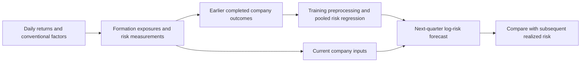

# Follow one company forecast in Python

This example follows JPMorgan Chase from its 31 December 2024 formation measurements to its 2025 Q1 residual-risk outcome. It compares the revised benchmark **B = conventional characteristics + recent risk + liquidity** with **B+S**, which adds signed conditional SMH loading. JPM is retained from an earlier worked example; the first late quarter is used for continuity, not because the extension wins. In fact, it worsens this observation's squared error.

The [standalone Python calculation](analysis/forecast_walkthrough.py) reconstructs the saved forecasts from prepared inputs and saved numeric coefficients. It checks **all 978 predictions—two models for 489 companies—at this formation**, not just the displayed company. It does not fit a new model or rebuild measurements from raw prices. The [full chronological fitting implementation](notebooks/recent-risk-and-liquidity.ipynb) remains available alongside its saved outputs.

## Two regressions with different jobs



The daily factor regression measures a company's historical return sensitivities. Conventional factors are the Fama–French market, size, value, profitability and investment factors plus momentum. The conditional SMH coefficient measures the remaining semiconductor co-movement after accounting for those factors. It can be negative and is not a forecast of company volatility.

The second regression learns a mapping from formation characteristics to **next-quarter log annualized residual volatility**. It pools company observations from earlier completed quarters. Its SMH coefficient says how a standardized exposure enters that risk forecast, conditional on the other inputs. Those two coefficients have different units and purposes.

## 1. Freeze the inputs and target definition

JPM's saved 504-session estimation window runs from **29 December 2022 through 31 December 2024**. Its signed conditional SMH loading is **−0.07873570**. Other formation characteristics include conventional factor loadings, issuer size, momentum, long-window residual risk, market/downside terms, 60-session log residual risk, 252-session Amihud illiquidity and 60-session dollar volume. The liquidity inputs are log mean Amihud illiquidity per USD million and log median dollar volume. Recent risk applies the long-window conventional coefficients over the recent window. The [prepared-feature definitions](METHODS.md#prepared-recent-risk-and-liquidity-inputs) specify calculations, units, coverage and exclusions; the comparison manifest selects the horizons and model combinations.

The forecast outcome uses the conventional factor coefficients fixed at formation. For subsequent daily excess returns, write:

$$
e_{i,t}=r^e_{i,t}-\widehat\alpha_{i,0}-F_t^\top\widehat\beta_{i,0},\qquad
y_i=\log\!\left(\sqrt{252\,\operatorname{Var}_{n-1}(e_{i,t})}\right).
$$

The future returns and factor realizations are used **afterward to score the forecast**, not as inputs to it. Both B and B+S predict this same conventional-factor residual target. Adding S to the forecasting regression does not remove SMH from the realized outcome. The residual also need not be pure business-specific risk: changing exposures and omitted common influences can remain in it.

The [prepared measurements](reproduction/company-risk/extensions/company_risk/data/processed/formation_measurements.csv) and [outcomes](reproduction/company-risk/extensions/company_risk/data/processed/company_outcomes.csv) preserve the estimation dates, formation identifiers and eligibility reasons. Their source identities are recorded in the [scientific manifest](reproduction/manifest.json). This historical reconstruction retains the study's contemporary universe and data-vintage limitations; it is not a claim that every input existed in this exact form in December 2024.

## 2. Select the same eligible observations and respect time

The [declared comparison](reproduction/company-risk/extensions/company_risk/specification/comparison_manifest.json), `semiconductor_main`, fits B, B+S, B+V and B+S+V on their **union-feature eligible sample**. Displaying only B and B+S does not relax that rule. V is the saved semiconductor variance-composition characteristic; no V model is selected here because it performed better.

The script joins features and outcomes on issuer, formation date and exposure window with a one-to-one check. Training uses earlier formations whose outcomes have finished by the forecast date:

```python
train = sample.loc[
    (sample.formation_date < formation)
    & (sample.outcome_end <= formation)
]
```

At this date that gives **13,261 issuer-quarter training observations across 28 formation quarters**, with the last completed outcome ending 31 December 2024. The eight-quarter minimum is satisfied. The 28 training quarters include initial training observations; they are not the 26 scored quarters reported for the study as a whole. Both displayed models evaluate the same **489 companies** in 2025 Q1.

## 3. Apply training-only transformations and saved coefficients

For each numeric input, the source uses the training mean and population standard deviation (`ddof=0`; zero scales become one):

$$z_j=(x_j-\mu_{j,\mathrm{train}})/s_{j,\mathrm{train}}.$$

Sector categories and omitted-category coding also come from training. B+S gives JPM's SMH loading a standardized value of **−0.29095851**. Its saved forecasting coefficient is **+0.01804527**, so the SMH term by itself contributes **−0.00525042** to predicted log risk.

The original source fits the pooled OLS coefficients using `pinv(X.T @ X) @ (X.T @ y)` and records rank and conditioning diagnostics. This walkthrough uses the [saved coefficient and preprocessing extract](evidence/walkthrough/preprocessing.csv); it does not solve that regression again. It checks the exported means and scales against the training rows before applying them.

There is one export boundary: the source saves numeric coefficients but does not export the intercept or sector-dummy coefficients. With an intercept and sector dummies, OLS residuals sum to zero within each training sector. Holding the saved numeric slopes fixed therefore recovers their **combined sector offset**:

```python
numeric_train = z_train.to_numpy() @ saved_beta
offsets = (train.log_residual_vol - numeric_train).groupby(train.sector).mean()
predicted_log_vol = z_test.to_numpy() @ saved_beta + test.sector.map(offsets)
```

This uses only training outcomes. It does not derive an offset from the saved test prediction or JPM's future outcome. All evaluation sectors at this date were present in training. The reconstructed forecasts agree with the saved predictions to within **2.1 × 10⁻¹⁴**. The [feature-contribution table](evidence/walkthrough/feature_contributions.csv) exposes every numeric input, transformation, coefficient and contribution; [the saved trace](evidence/walkthrough/forecast_trace.json) records the totals and checks.

| Forecast component, in log-volatility units | B | B+S |
|---|---:|---:|
| Sum of numeric contributions | −0.37353747 | −0.37132624 |
| Intercept plus Financials-sector offset | −1.51196666 | −1.51076033 |
| Predicted log residual volatility | **−1.88550413** | **−1.88208656** |

The **full forecast rises by +0.00341756**, even though the SMH term is negative. Adding S re-estimated the other slopes and category offsets in the original experiment. The full difference between two forecasts is not the new coefficient multiplied by the new exposure alone.

## 4. Observe the next quarter and score both forecasts

The recorded outcome uses **60 sessions, 2 January–31 March 2025**. JPM's realized annualized residual volatility is **0.14715879**, or about **14.716%**; its log is **−1.91624309**.

| Company calculation | B | B+S |
|---|---:|---:|
| Predicted log residual volatility | −1.88550413 | −1.88208656 |
| Realized log residual volatility | −1.91624309 | −1.91624309 |
| Squared log forecast error | 0.0009448839 | 0.0011666685 |

```python
loss_b = (actual_log_vol - prediction_b) ** 2
loss_e = (actual_log_vol - prediction_e) ** 2
d = loss_b - loss_e
```

Here **d = −0.0002217846**: adding signed SMH exposure worsens this company's squared error in this quarter. This one example illustrates the mechanics; it cannot identify a reliable company beneficiary or loser.

Exponentiating the log predictions gives 15.175% and 15.227%. Those are back-transformed log forecasts, not automatically expected volatility or the separate variance forecasts. The study's variance outputs additionally use a training-only retransformation factor. That correction is verified by the script but does not enter the primary unsmeared log-volatility MSE above.

## 5. Aggregate without changing the question

Average squared errors equally over the 489 matched companies. The quarter's MSEs are **0.068971615** for B and **0.069027789** for B+S, reconciling to the [saved quarterly scores](evidence/walkthrough/quarter_scores.csv). The relative improvement is **−0.081446%**:

```python
gain_pct = 100 * (mse_b - mse_e) / mse_b
```

The study's period headline averages these percentages equally across quarters. It does not pool all company rows or average individual-company percentage gains. This quarter, the complete six-quarter late block, and company/sector summaries answer different aggregation questions. The [subgroup appendix](SUBGROUPS.md) shows how to retain counts, adverse observations, uncertainty and additive contributions when looking beneath the headline.

## Run the reconstruction

After installing the [documented environment](REPRODUCE.md), run from the package directory:

```sh
python analysis/forecast_walkthrough.py --output runs/forecast-walkthrough
```

The output directory must be new. The script verifies input hashes, join uniqueness, training cutoffs, saved preprocessing, prediction agreement, training-only retransformation and quarterly loss arithmetic. It writes the trace, feature contributions, recovered sector offsets and the full evaluation prediction check. Input fingerprints and exact source selections are in [walkthrough provenance](evidence/walkthrough/provenance.json).

For a full rerun of the original revised-study fitting procedure from prepared measurements, use `reproduce.py --study company-risk --notebooks 03 04 05` as described in the reproduction guide. That is a different scope from this coefficient reconstruction and still does not independently rebuild upstream measurements from market data.

[Overview](README.md) · [Findings](FINDINGS.md) · [Methods](METHODS.md) · [Subgroup support](SUBGROUPS.md)
