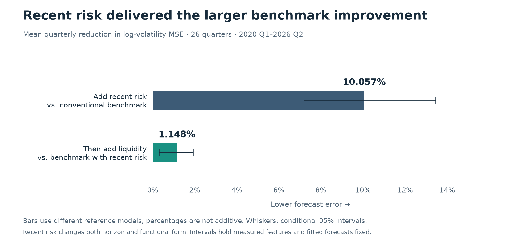

# quiet-index — Can semiconductor exposure improve equity-risk forecasts?

**Independent research by Sai Reddivari, informed by my CQF studies.**

Does semiconductor exposure improve equity-risk forecasts once the model already accounts for conventional factors, recent risk and liquidity? This project tests that question across 500 companies, alongside a separate test of semiconductor exposure in portfolio-risk forecasts.

My starting concern was the concentration of risk around the AI buildout: suppliers, major customers and infrastructure projects could depend on common spending assumptions. I used semiconductor equity exposure as an observable starting point. This study tests a narrower question about equity-risk forecasts; it does not measure data-center debt, refinancing pressure or collateral losses.

The candidate signal is a stock's tendency to move with semiconductor stocks after conventional equity factors are accounted for. That relationship can be measured for companies throughout the population, rather than assigned only to semiconductor firms. It offers a way to test an industry-linked source of return variation beyond broad market and investment-style exposures. The investigation asks how much forecasting value survives increasingly demanding comparisons.

The main finding is that **stronger company benchmarks narrowed the evidence for stable additional semiconductor forecasting value**. Recent risk substantially improved the comparison model; liquidity supplied a smaller, conditional improvement. Semiconductor exposure then added little to broad company forecasts, although favorable results remained for semiconductor companies under some controls. The separate portfolio experiment showed why assumptions about relationships between stocks also matter.

[Findings](FINDINGS.md) · [Python forecast walkthrough](FORECAST_WALKTHROUGH.md) · [Calculation notebooks](notebooks/README.md) · [Results and figures](#a-stronger-reference-model-changes-the-result)

## From the S&P 100 exploration to 500-company forecasts

My [original S&P 100 quiet-index exploration](https://github.com/sai-reddivari/quiet-index) examined risk concentration, individual stocks' contributions to volatility and sensitivity to different covariance estimators. Its semiconductor-linked exposure helped describe where risk sat, but that did not establish a distinct predictive signal beyond ordinary market beta. Its separate SPY forecasting and VaR exercises also have different targets from the company forecasts here.

I expanded the investigation to 500 companies and made the incremental question explicit: after conventional factors and company characteristics, does conditional SMH exposure help forecast next-quarter residual risk? I estimated exposures from daily returns, then used those measurements as inputs to a second, chronological company-risk regression. A separate portfolio comparison evaluated covariance forecasts.

The initial company gains were small and changed across periods. I examined calibration, recent risk and trading activity, then strengthened the revised benchmark with recent residual volatility and liquidity before testing semiconductor characteristics again. The intermediate calibration model already contained semiconductor exposure, so its improvements are evidence about the benchmark, not another clean test of adding SMH.

Finally, I checked whether the broad average hid company or sector benefits. The semiconductor-group gains under sector controls were meaningful historical results, but they reversed under finer industry controls. This changed the conclusion I could defend: the work supports a better-tested reference forecast and a more qualified semiconductor claim, not a universal winning signal. The [Python forecast walkthrough](FORECAST_WALKTHROUGH.md) follows one revised forecast through the actual calculations; the [subgroup appendix](SUBGROUPS.md) makes the later diagnostic reproducible.

Here, a **benchmark** means the reference forecasting model against which an added predictor is judged. It is not an index return to beat. If a simpler model omits useful information, an added characteristic may look valuable partly because of that omission. Strengthening the reference model makes the test more demanding: does semiconductor exposure still help when recent risk and liquidity are already represented? These comparisons refine the same historical investigation; they are not independent replications.

## What is measured and predicted

The population comes from a fixed September 2026 holdings snapshot of **IVV, an S&P 500 exchange-traded fund: 503 securities representing 500 companies**. Company forecasts use one representative security per issuer. The original and revised company evaluations span **26 quarters, from 2020 Q1 through 2026 Q2**, with the later results examined separately for 2023–24 and 2025–2026 Q2.

“Semiconductor exposure” has a specific statistical meaning here. It measures a stock's historical return co-movement with **SMH, a semiconductor exchange-traded fund**, after accounting for conventional equity factors: broad-market returns and return patterns associated with size, value, profitability, investment and momentum. Its sign captures the direction of that conditional relationship. It is not a measure of semiconductor revenue, supply-chain involvement or fundamental exposure to AI.

The company target is **next-quarter residual volatility**: the variability of returns left after applying a conventional factor model. The factor coefficients are estimated at the forecast date and held fixed when measuring the subsequent outcome. Consequently, the residual can contain changing exposures and omitted common influences as well as company-specific variation. It should not be read as pure business risk. The forecast target is the logarithm of annualized residual volatility.

The main company models use pooled ordinary least squares: a supervised regression approach that learns from observations across companies and earlier completed quarters. Training expands chronologically, and preprocessing uses training data. Each paired comparison scores the models on the same eligible observations. This is an application of statistical learning to risk forecasting, with linear regression as the main predictive model.

Forecast accuracy is measured by **mean squared error (MSE)** in log volatility. Within each quarter, squared prediction errors are averaged across eligible companies. An improvement is the percentage reduction in that quarter's MSE relative to the comparison model's own MSE; the reported result then averages those percentages equally across quarters. These percentages describe forecast errors, not reductions in actual company risk, and are not ratios of period-average losses.

## A stronger reference model changes the result

The revised conventional benchmark includes factor loadings, company size, past returns, long-window residual volatility, market/downside terms and sector controls. The next comparison adds residual volatility measured over the most recent 60 trading sessions. A further addition captures liquidity through 252-session Amihud illiquidity—a price-movement-relative-to-trading measure—and 60-session dollar volume.

Across the 26 quarters, adding recent risk improved MSE by about **10.1%** on the quarterly-average definition above. Adding liquidity to the model already containing recent risk improved it by a further **1.1%**, relative to that stronger model. The percentages have different denominators and should not be added.

*Source: [saved company comparisons](evidence/company_inference.csv). These are improvements in forecast accuracy, not reductions in realized risk. The intervals condition on measured features and fitted forecasts.*

The first result is not a clean estimate of a “recency effect”: the addition changes both the measurement window and the functional form, introducing recent volatility in logs alongside raw long-window volatility. Liquidity's remaining benefit was mostly associated with better calibration—less systematic over- or underprediction—and its direction changed in a short-window sensitivity. It therefore supports conditional usefulness rather than a universal advantage.

In the original sector-controlled comparison, signed semiconductor exposure improved broad company MSE by about **1.0% in 2023–24**, then worsened it by **0.4% in 2025–2026 Q2**. Against the fuller revised benchmark, those results became approximately **0.4% improvement** and **0.5% deterioration**, respectively. Other principal semiconductor representations were also small or adverse, though some shorter-window sensitivities were favorable. The evidence did not establish a stable broad increment. It does not show that semiconductor dependence is absent, or that recent risk causally “explained away” that dependence.

## Semiconductor companies provide important counterevidence

A small broad average can conceal a useful result within a group. For the **19 semiconductor companies**, the six-quarter late period contains all 114 company-quarter observations. Adding signed exposure produced the following mean quarterly MSE changes; positive values mean better forecasts, and each comparison uses its own reference model.

| Controls used in both compared models | Initial factor benchmark | Benchmark with recent risk and liquidity |
|---|---:|---:|
| Broad sectors | +11.548% | +5.160% |
| Finer industry groups | −1.644% | −0.704% |

*Source: [saved subgroup comparisons](evidence/group_comparisons.csv). These point estimates cover 19 semiconductor companies over six late quarters; changing controls refits both compared models.*

The sector-controlled gains were favorable in five of the six quarters in both studies. Those gains deserve to be retained alongside the weaker broad result. However, they reversed when the models included finer industry controls, which ask whether continuous semiconductor exposure adds information beyond industry membership. Changing those controls refits both models; it does not isolate a causal industry-membership effect.

The favorable results mainly concerned calibration rather than demonstrated improvement in ordering companies by risk. The diagnostic examined many groups on already-used periods, with only six late quarters. These are meaningful historical qualifications, not established reliable winners.

## Portfolio risk asks a different question

Portfolio risk depends on how stocks move together, as well as on their individual volatility. The portfolio experiment therefore evaluates **covariance models**, separately from the company regressions; it does not combine the company-risk forecasts into a portfolio.

It compares historical covariance estimates with next-quarter realized portfolio variance using **QLIKE**, a variance-forecast loss. Reported improvements are absolute differences in loss, not the company MSE percentages above. In the late period, adding SMH helped slightly when residual relationships between different securities were set to zero. It worsened the point estimate when residual covariance was retained within industry groups. Both uncertainty intervals included zero; adding Treasury controls barely changed the comparison.

The accounting explains why this matters. Under the matched estimation conditions, expanding the factor model while retaining full within-industry residual covariance leaves individual historical variances and within-industry covariances unchanged. It changes the cross-industry entries. Thus the portfolio test concerns how a restricted model carries historical dependence into the future. A mathematically consistent covariance reconstruction does not itself establish a better forecast.

## How far the conclusions travel

The fixed contemporary population, classifications and portfolio weights are applied retrospectively, introducing survivorship and hindsight limitations. The studies reuse market episodes, and the late evaluation contains only six quarters. Reported uncertainty conditions on measured features and fitted forecasts; it does not repeat estimation of the entire research pipeline. Chronological model fitting does not make these now-inspected periods an untouched holdout.

This is historical risk research, not an investable backtest or evidence of a causal semiconductor mechanism. It was conducted independently and was neither assessed nor endorsed by CQF. The resulting evidence favors the strengthened company benchmark more clearly than a broad semiconductor addition. It also leaves a specific unresolved qualification: semiconductor-company gains under sector controls did not survive finer industry controls, while portfolio results depended on the residual covariance restriction.

## Research and development approach

I conducted this work through **AI-assisted research and development**. I supplied the economic questions and candidate indicators, and used AI to develop and implement exploratory approaches quickly. I then returned to the work through hands-on analysis, substantial code review and revisions, using my own judgment to shape the revised study and final conclusions. AI assistance supported implementation, documentation and review throughout that process.

Two concrete examples of my hands-on work are `fit_chronological_company_models` and `decompose_quarterly_mse`, shown in the [recent-risk and liquidity notebook](notebooks/recent-risk-and-liquidity.ipynb). On my own private branch, I rewrote these functions by hand to work through how I would structure their data handling, logic and stability checks. The first follows the chronological training, preprocessing and forecasting sequence; the second separates quarterly forecast error into calibration and centered-error components. Those private rewrites were part of my development and review process. This publication retains the frozen study implementations and their verified outputs.

AI-assisted development describes how I worked. The statistical methods used here are factor regressions, pooled ordinary least squares for company-risk forecasting, MSE decomposition, factor/residual covariance estimation and circular-block resampling for conditional uncertainty. The methods, saved evidence and limitations below explain what those calculations establish.

## Explore the evidence and calculations

Start with the [Python forecast walkthrough](FORECAST_WALKTHROUGH.md) to inspect the implementation, or the [subgroup appendix](SUBGROUPS.md) to examine benefits and adverse evidence. The [findings and synthesis](FINDINGS.md) give exact results, uncertainty intervals and sensitivities. [Methods and evidence](METHODS.md) connect the definitions and claims to saved tables. The [selected notebooks](notebooks/README.md) provide calculation code and saved outputs for closer inspection.

The two figures above are generated directly from the bundled evidence tables using [this plotting script](assets/build_readme_figures.py); SVG versions are available in [assets](assets/).

The package includes executable scientific sources and frozen prepared measurements. [Reproduction instructions](REPRODUCE.md) explain which comparisons run from bundled inputs and which also require authorized access to private frozen vendor data. The [verification record](VERIFICATION.md) documents completed runs and numerical agreement with saved evidence. Those checks verify selected calculations, not a full raw-data rebuild or independent empirical replication. Interpretation remains a research draft.
